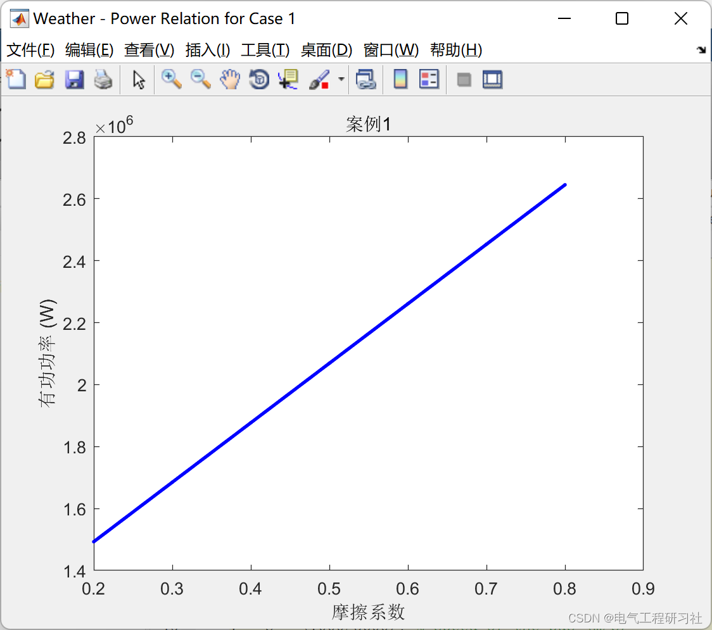
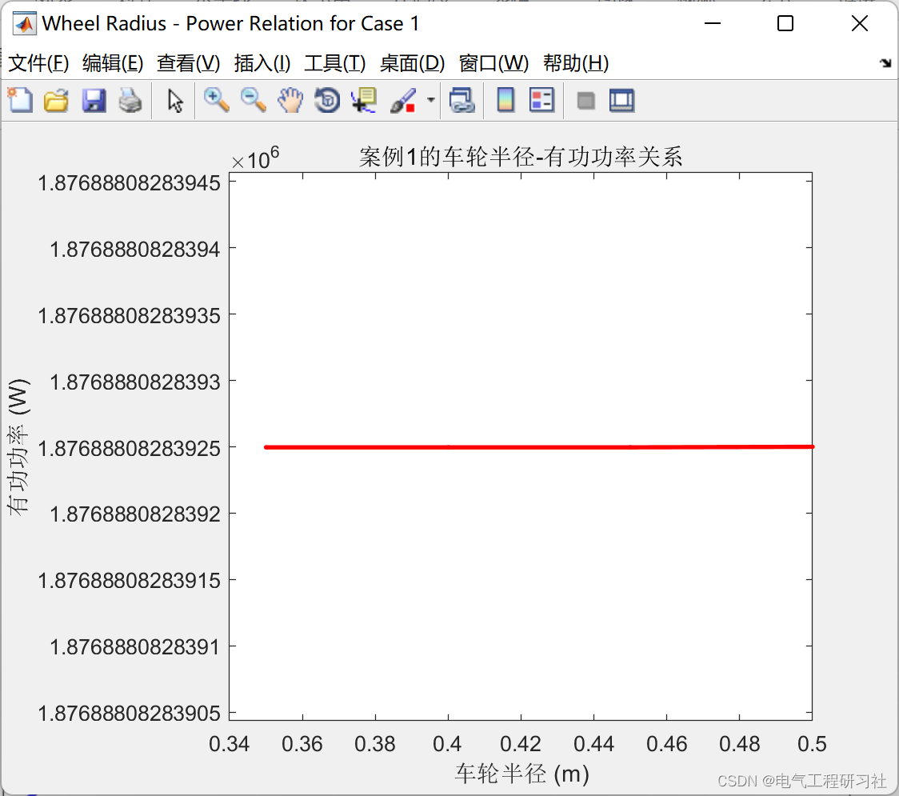
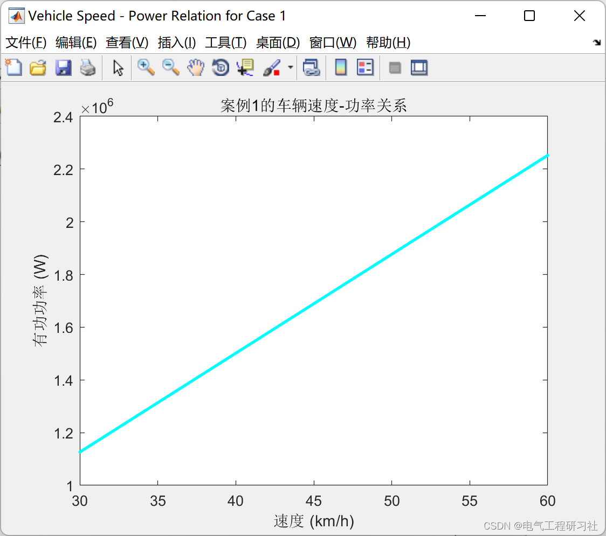
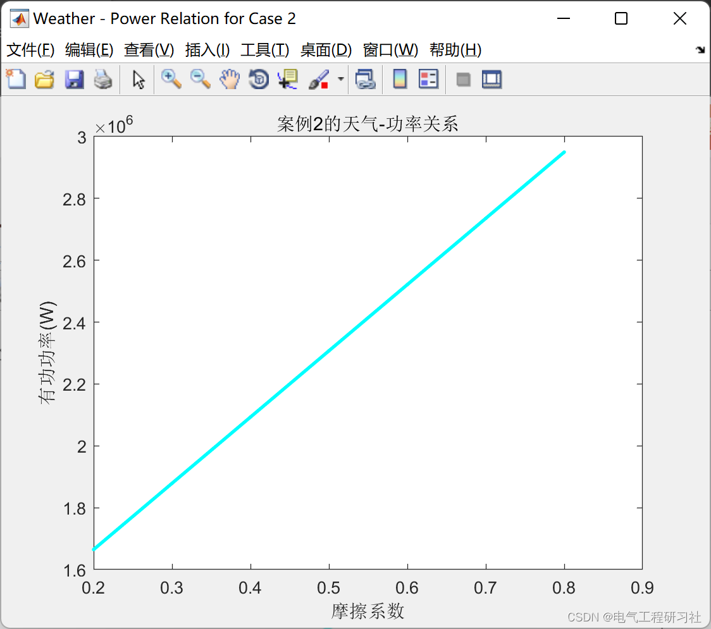
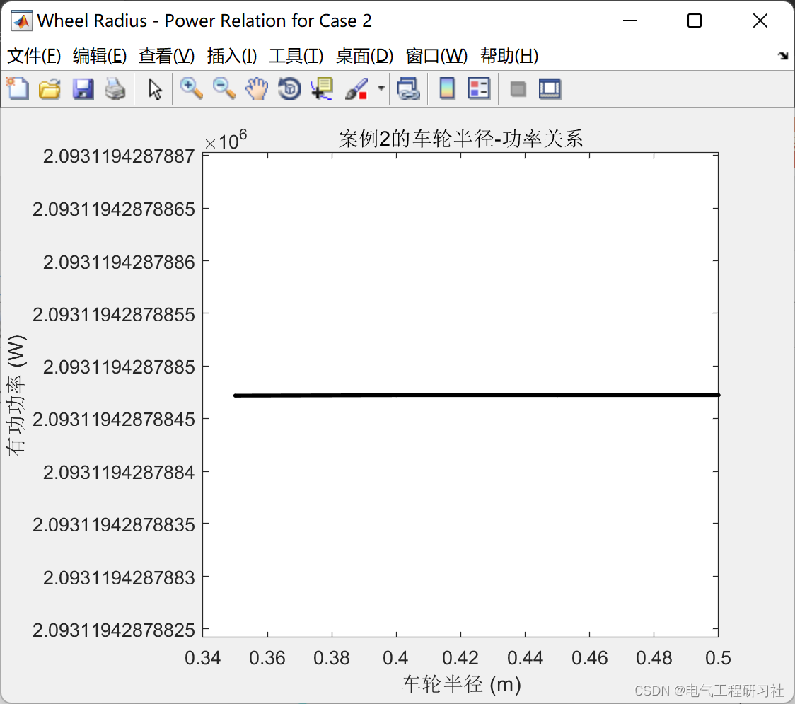
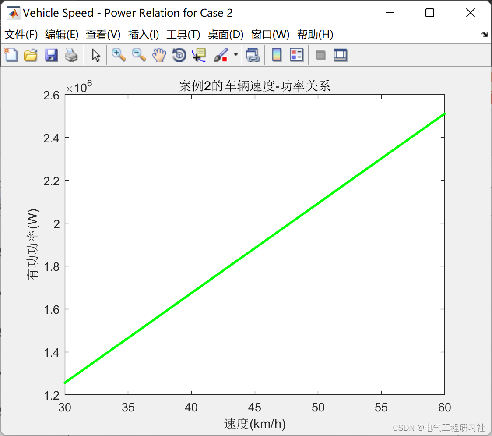
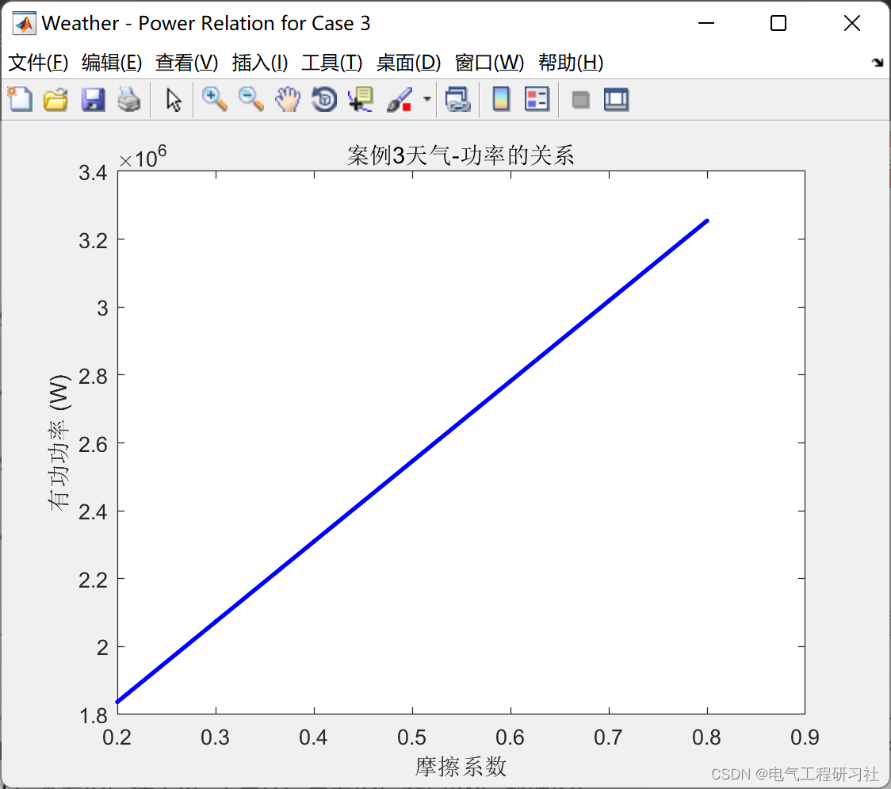
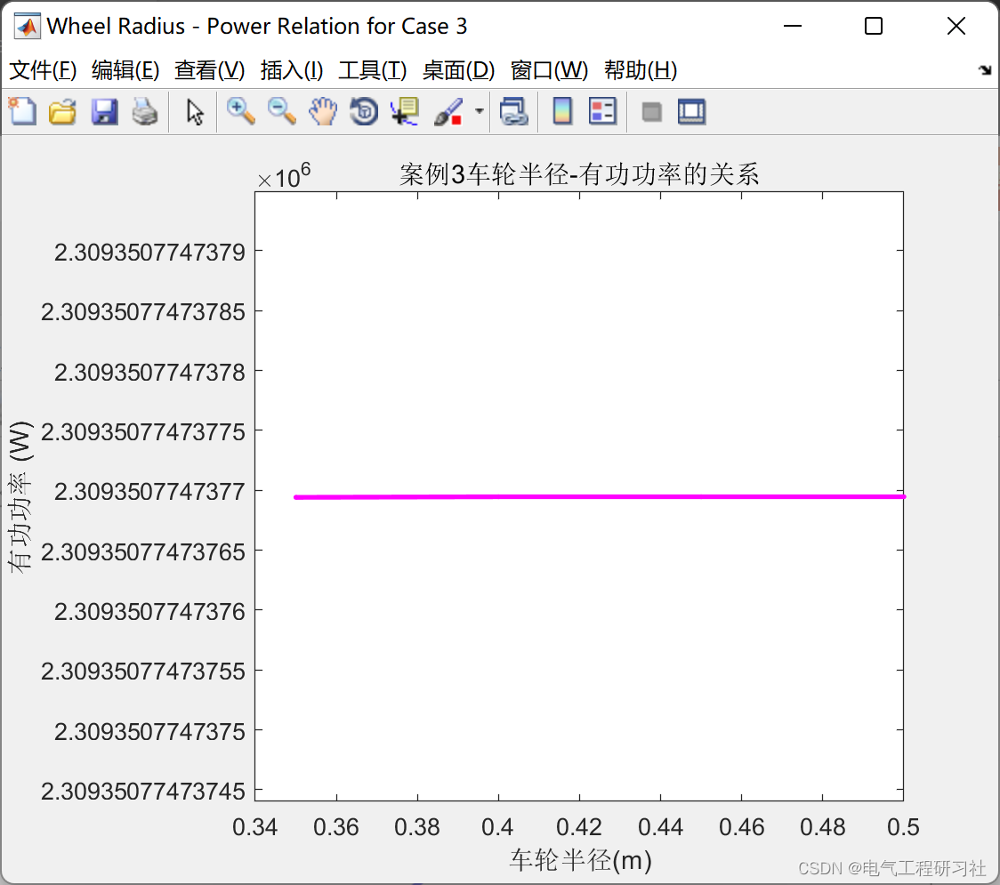
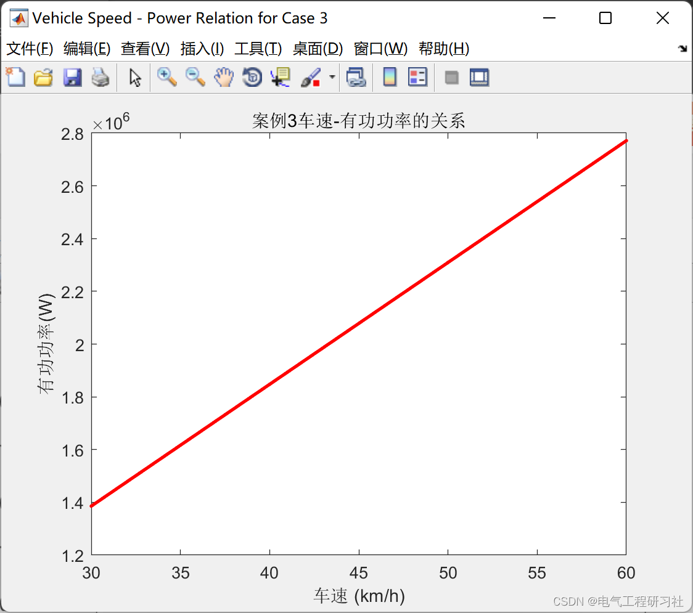

# Optimized Dispatching of Electric Vehicles Based on Scenario Analysis (Matlab Code Implementation)

​  
In recent years, the development of electric vehicles (EVs) has attracted increasing attention. As mobile energy storage units, EVs can achieve energy exchange with the power grid. However, the random charging and discharging characteristics make it difficult to integrate EVs. The most common charging modes for EVs are traditional charging, fast charging, and battery replacement. Firstly, a charging model is proposed for various scenarios of random charging for EVs. A statistical model for the time-series distribution of load for EVs is established using a random sampling method. The proposed model can well reflect the charging cluster characteristics of large-scale EVs randomly connected to the grid. Then, considering the discharge characteristics of EVs within a specified period, a charging and discharging cluster model based on Latin hypercube sampling method is established. The clustering model can reflect the time-series distribution characteristics of EVs within a 24-hour cycle. Finally, the model verifies the impact of peak load transfer in EVs.
2 Case Study: No Passenger Power = 1876888.08 W
Starting current = 18.77 A
Starting Torque = 228271.54 N-m
Rated current = 5.00 A
Rated torque = 60811.17 N-m
The startup current is within the safety limit.
Case 2: Half of the Passenger Power = 2093119.43 W
Starting current = 20.93 A
Starting torque = 283898.45 N-m
Rated current = 5.00 A
Rated torque = 67817.07 N-m
The startup current is within the safety limit.
Case 3: All Passenger Power = 2309350.77 W
Starting current = 23.09 A
Starting Torque = 345584.94 N-m
Rated current = 5.00 A
Rated torque = 74822.97 N-m
The startup current is within the safety limit.
3. Running Results Editing
Editor
Editor
Editor
Editor
Editor
Editor
Editor
Editor
4. MATLAB code implementation
figure('Name','Vehicle Speed - Power Relation for Case 1','NumberTitle','off'); \nplot(s_array,P_array,'Color','c','Marker','.','LineWidth',2); \ntitle('Case 1: Vehicular Speed-Power Relation'); \nxlabel('Speed (km/h)'); \nylabel('Power (W)'); \n
​  

## Images

<!-- PAYMENT_BLOCK -->

## Get this dataset

- Payment link (Stripe): [Buy now](https://buy.stripe.com/3cs8yP7sY87d0vu9AB)
- Payment QR code: 

<!-- /PAYMENT_BLOCK -->
